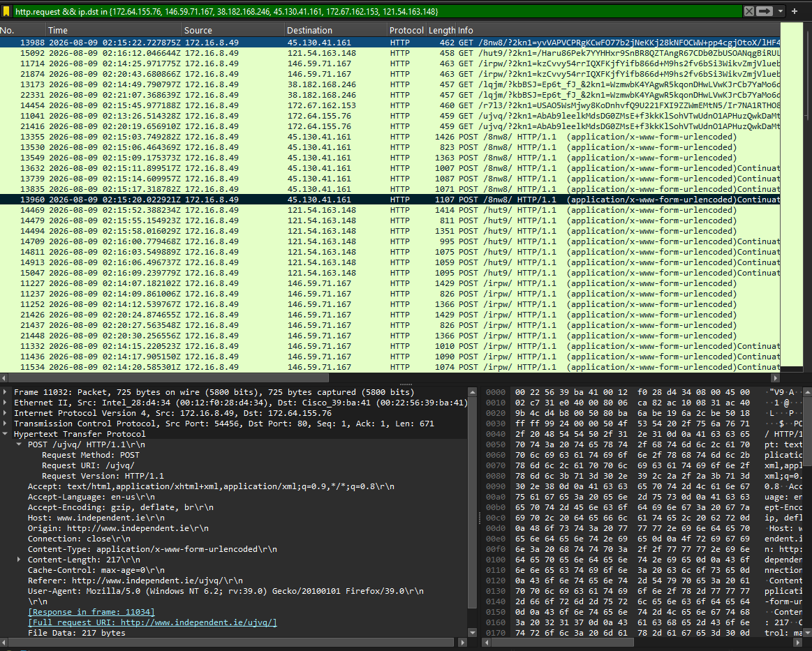
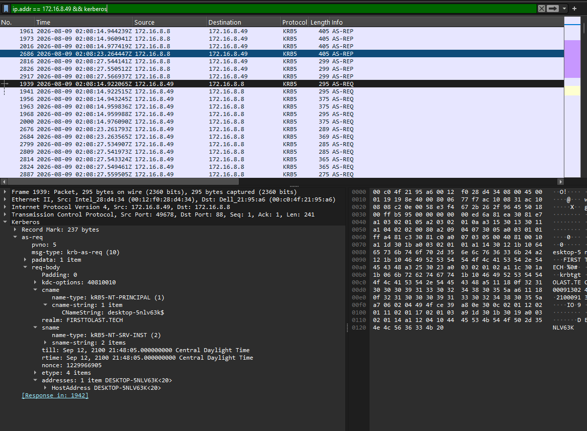
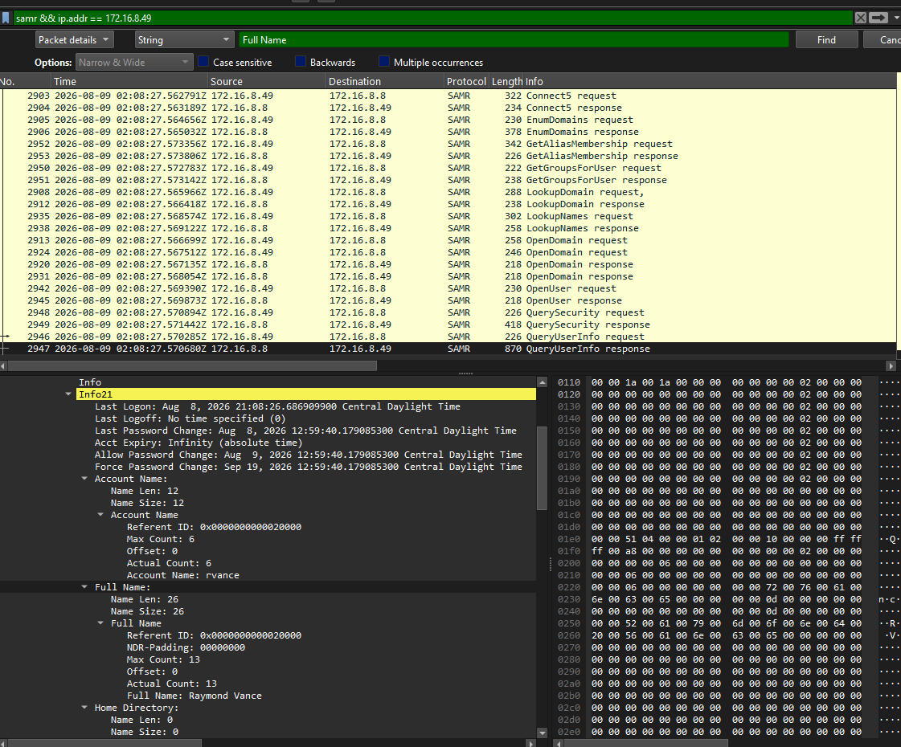

# PCAP Analysis #1 — First to Last

This write-up documents my analysis of the **August 9, 2026 “First to Last” traffic-analysis exercise** from [Malware-Traffic-Analysis.net](https://www.malware-traffic-analysis.net/2026/08/09/index.html). I used Wireshark to trace traffic associated with FormBook alerts to a Windows client and identify its computer and user accounts.

This is a public training exercise. **The findings below contain exercise spoilers.**

## Investigation objectives

The exercise asks for five details about the infected Windows client:

- IP address
- MAC address
- Hostname / computer name
- User account name
- User's full name

## Final findings

| Item | Finding |
|---|---|
| Infected client IP | `172.16.8.49` |
| Client MAC address | `00:12:f0:28:d4:34` |
| Hostname / computer name | `DESKTOP-5NLV63K` |
| User account | `rvance` |
| User's full name | Raymond Vance |

## 1. Start with the alert destinations

My first question was: **Which internal device is sending the traffic associated with the alerts?**

Rather than inspect every packet individually, I filtered HTTP requests to the destination IP addresses listed in the exercise:

```wireshark
http.request && ip.dst in {172.64.155.76, 146.59.71.167, 38.182.168.246, 45.130.41.161, 172.67.162.153, 121.54.163.148}
```

The matching requests repeatedly showed `172.16.8.49` as the source. This linked the internal client to the alert destinations and gave me an address to use for the rest of the investigation.

The screenshot below shows multiple GET and POST requests from that client. The packet-details pane displays **frame 11032**, an HTTP POST from `172.16.8.49` to `172.64.155.76` on port 80.



## 2. Identify the client's MAC address

Once I had the client IP, I examined the Ethernet details of a packet sent by that client.

The same screenshot shows:

```text
IPv4 source: 172.16.8.49
Ethernet source: 00:12:f0:28:d4:34
Wireshark resolved label: Intel_28:d4:34
```

At first, I needed to distinguish the resolved Ethernet label from a Windows hostname. `Intel_28:d4:34` is a vendor-resolved MAC label. The full numeric source MAC is the value needed for the report.

**Finding:** The client's MAC address is `00:12:f0:28:d4:34`.

## 3. Inspect HTTP exchanges without assuming C2 success

I used **Follow → TCP Stream** to inspect suspicious requests and their responses. My question was whether the client merely attempted to communicate or received a meaningful C2 response.

Two exchanges illustrated why the response body matters:

| Destination hostname | Request | Response | Interpretation |
|---|---|---|---|
| `www[.]grinswakebthu[.]info` | `GET /irpw/` with query parameters | HTTP `404 Not Found` and an HTML error page | An HTTP server answered, but successful C2 was not established |
| `www[.]taibeinan[.]cc` | `POST /lqjm/` with a declared 3,225-byte body | HTTP `200 OK` with a JSON error | HTTP status alone did not establish C2 success |

The second response contained:

```json
{"code":404,"msg":"404 not found","data":{}}
```

Although the HTTP status was `200 OK`, the application response reported that the resource was not found and supplied an empty data object.

Both requests included a parameter named `2kn1` with an opaque value. This was a pattern worth comparing, but I could not determine its contents from appearance alone.

**Conclusion:** These exchanges show HTTP communication. They do not independently prove successful C2 operation or data exfiltration. This conclusion applies to the reviewed streams, not necessarily every connection in the capture.

*These stream observations were recorded during analysis; the three screenshots included here document host identification rather than those complete exchanges.*

## 4. Find the hostname through Kerberos

Next, I wanted to identify the Windows computer behind `172.16.8.49`.

An NTLM search returned no results, so I moved to Kerberos:

```wireshark
ip.addr == 172.16.8.49 && kerberos
```

In **frame 1939**, a Kerberos AS-REQ from `172.16.8.49` to `172.16.8.8`, I expanded:

**Kerberos → as-req → req-body → cname → cname-string**

The client name was:

```text
 desktop-5nlv63k$
```

The trailing `$` indicated a computer account rather than the human user's account. The Kerberos host-address field also showed `DESKTOP-5NLV63K`, supporting the computer name.



**Finding:** The hostname / computer name is `DESKTOP-5NLV63K`.

## 5. Distinguish the user account from the computer account

After identifying the computer account, I continued looking through Kerberos client names for a user account:

```wireshark
ip.addr == 172.16.8.49 && kerberos.CNameString
```

I found `rvance` in a CNameString. This gave me a candidate user account to corroborate with account-information traffic.

The distinction mattered: `desktop-5nlv63k$` identified the computer account, while `rvance` identified a separate user account. Neither value alone supplied the person's full name.

*The Kerberos packet containing `rvance` is not included in the supplied screenshots. The SAMR evidence below explicitly confirms the account name and its associated full name.*

## 6. Match the account to the user's full name

To resolve the full name, I examined SAMR account-information traffic involving the client:

```wireshark
samr && ip.addr == 172.16.8.49
```

I used Wireshark's packet search with **Packet details → String → Full Name** to locate relevant fields. The screenshot shows **frame 2947**, a QueryUserInfo response from `172.16.8.8` to `172.16.8.49`.

In the expanded **Info21** structure, the same user entry contains:

```text
Account Name: rvance
Full Name: Raymond Vance
```

This explicitly connects the account name to the person's full name, rather than requiring me to guess from the username.



**Finding:** The user account is `rvance`, and the associated full name is **Raymond Vance**.

## Evidence summary

| Finding | Supporting evidence |
|---|---|
| `172.16.8.49` | Repeated HTTP requests to alert-listed destinations in screenshot 1 |
| `00:12:f0:28:d4:34` | Ethernet source associated with the client IP in screenshot 1; frame 11032 is displayed in the details pane |
| `DESKTOP-5NLV63K` | Kerberos computer account and host-address fields in frame 1939, screenshot 2 |
| `rvance` | Account Name field in the SAMR response, frame 2947, screenshot 3 |
| Raymond Vance | Full Name field in that same SAMR user entry, screenshot 3 |

## Lessons learned and limitations

- Starting with the alert destinations helped narrow the investigation to one internal client.
- A vendor-resolved MAC label is different from a Windows hostname.
- An empty NTLM search does not mean identity information is unavailable; Kerberos provided another route.
- Computer accounts and human user accounts must be distinguished before drawing identity conclusions.
- SAMR supplied an explicit account-to-full-name mapping.
- HTTP `200 OK` does not by itself establish successful malware communication.
- The exercise page lists `172.16.8.2` as the domain controller, while the supplied Kerberos and SAMR screenshots show exchanges with `172.16.8.8`. I preserve the observed addresses here rather than assume they are interchangeable.
- Wireshark displays some embedded protocol timestamps in local time. Those fields are distinct from packet-list timestamps and should not be substituted for capture times when building an incident timeline.

## Source and attribution

- [First to Last — exercise background and original capture](https://www.malware-traffic-analysis.net/2026/08/09/index.html)
- [Wireshark Kerberos field reference](https://www.wireshark.org/docs/dfref/k/kerberos.html)
- [Wireshark SAMR field reference](https://www.wireshark.org/docs/dfref/s/samr.html)

The exercise and original capture are provided by Malware-Traffic-Analysis.net. This folder contains my write-up and analysis screenshots; download the capture from the original source.
